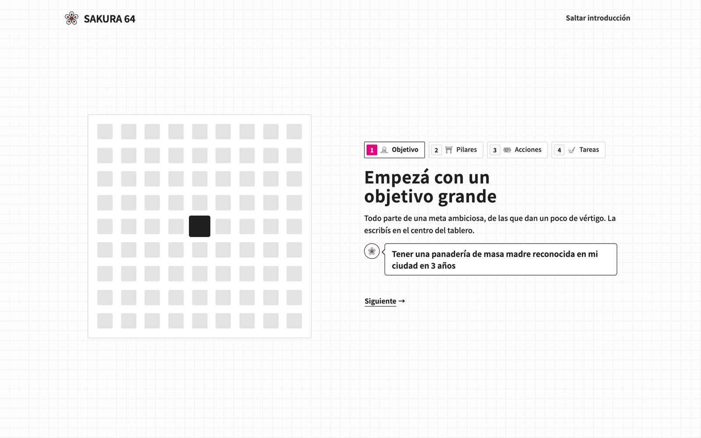
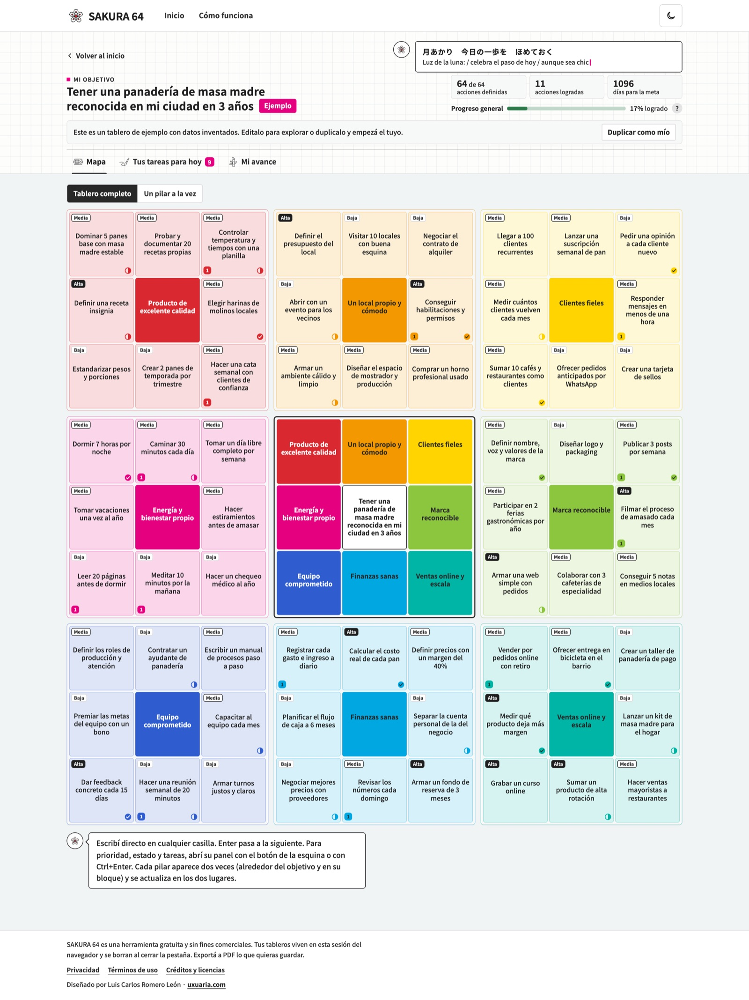
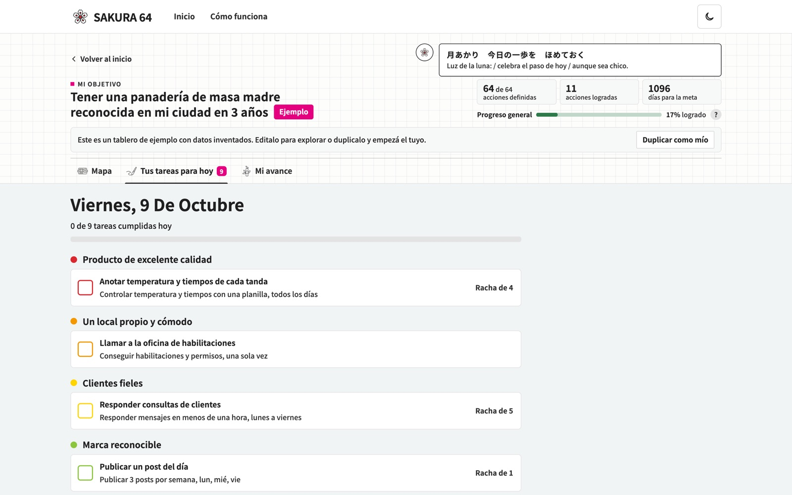
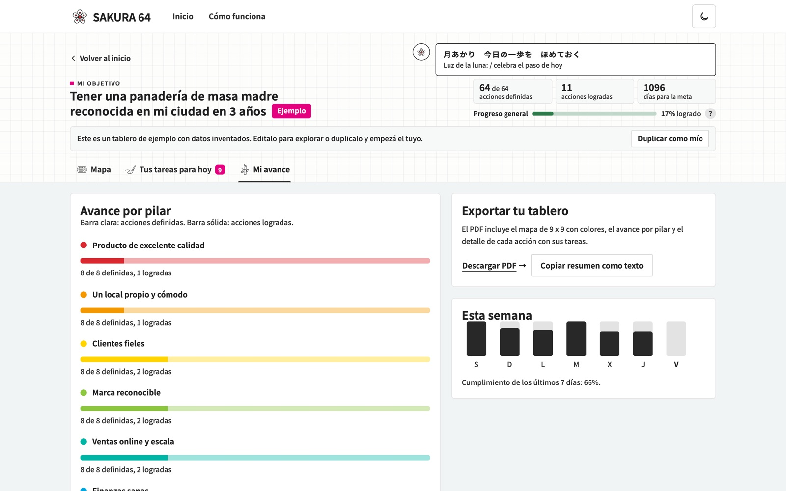

Tienes un proyecto creativo grande en la cabeza. Puede ser tu primer libro ilustrado, un estudio propio o una serie de cortos. Lo escribes y te bloqueas, porque no sabes por dónde empezar.

Eso le pasa a mucha gente creativa. Una meta grande sin desglosar se siente como una montaña. El **método Harada** sirve para resolver ese problema: convierte un objetivo ambicioso en 64 acciones concretas que puedes empezar esta semana.

En esta guía vas a ver qué es, de dónde viene, cómo armar tu tablero paso a paso y cómo hacerlo en línea con [SAKURA 64](https://sakura64.uxuaria.com/), una microapp gratuita que diseñé para esto. Y al final, una vuelta de tuerca: qué pasa cuando la meta del centro no es un libro, sino **un producto digital que no despega**.

## Qué es el método Harada

> El método Harada es un sistema japonés de fijación de metas creado por el docente Takashi Harada. Su herramienta más conocida es un tablero de 9 x 9 casillas. En el centro va una meta principal. Alrededor se ubican ocho pilares que deben cumplirse para alcanzarla, y cada pilar se divide a su vez en ocho acciones concretas. El resultado son 64 acciones que convierten un objetivo abstracto en un plan diario.

### De dónde viene

Takashi Harada trabajó 20 años como profesor en escuelas secundarias públicas de la ciudad de Osaka, Japón. En la tercera escuela donde enseñó, el equipo de atletismo que entrenaba logró 13 títulos nacionales en 7 años ([Jinjibu, 2008](https://jinjibu.jp/article/detl/keyperson/225/)).

A partir de 2003 llevó su método a la formación en empresas. Según el mismo perfil, en unos cuatro años trabajó con 200 compañías y más de 40.000 personas. En inglés se difundió con el libro *The Harada Method: The Spirit of Self-Reliance*, publicado en 2012 por PCS Press, la editorial de Norman Bodek ([Wikipedia](https://en.wikipedia.org/wiki/Norman_Bodek); [Lean Blog](https://leanblog.podbean.com/e/norman-bodek-the-harada-method)).

El tablero de 64 casillas se llama "Open Window 64". Es una de varias herramientas del método, junto con planillas de rutinas y un diario, tal como las presenta el propio Harada en *Hajimete no mokuhyō tassei nōto* ([Discover 21, 2023](https://www.kinokuniya.co.jp/f/dsg-01-9784799329887)).

## Lo que un creativo puede aprender de Shohei Ohtani

El caso más citado es el del beisbolista Shohei Ohtani. Armó su tablero en primer año de la secundaria Hanamaki Higashi, guiado por su entrenador Hiroshi Sasaki. En el centro escribió su meta: ser elegido en primera ronda del draft por 8 equipos ([Toyo Keizai, 2021](https://toyokeizai.net/articles/-/445400)).

Lo interesante para alguien creativo está en sus pilares. Junto a la técnica (control, velocidad, variedad de lanzamientos) aparecían la mentalidad, el carácter y la suerte. Para la suerte anotó acciones como juntar basura, ordenar su habitación y respetar a los árbitros ([Lifehacker Japón](https://www.lifehacker.jp/article/2507-shohei-ohtani-goal-realization/)). Una profesora de Harvard Business School incluso escribió un caso de estudio sobre su tablero ([Harvard Gazette](https://news.harvard.edu/gazette/story/2024/10/crush-your-goals-the-ohtani-way/)).

Llevado a tu trabajo, la idea es simple. Tu meta depende del oficio y también de tus hábitos, tu energía y la gente que te rodea. Un buen tablero incluye todo eso.

Con los productos digitales pasa lo mismo: casi nunca fallan por un solo motivo técnico. Fallan por los pilares que nadie anotó. Vamos a volver a esto más abajo.

## Cómo funciona el método Harada, paso a paso

El tablero tiene 81 casillas: 1 meta, 8 pilares y 64 acciones. Lo puedes armar en papel, en una planilla o directamente en [SAKURA 64](https://sakura64.uxuaria.com/).

### Paso 1: define una meta grande y ambiciosa

Escribe la meta en la casilla central. Tiene que ser importante para ti y darte un poco de vértigo.

Súmale un plazo y una forma de medirla. "Dibujar más" es difícil de trabajar. "Publicar mi primer libro ilustrado antes de diciembre de 2027" te da algo concreto.

### Paso 2: escribe ocho pilares

Pregúntate qué tiene que ser verdad para que esa meta se cumpla. Cada respuesta es un pilar. Anótalos en las ocho casillas que rodean el centro.

Piensa en distintas áreas: oficio, hábitos, comunidad, dinero, salud. Si todos tus pilares son técnicos, probablemente te falte algo.

### Paso 3: desglosa cada pilar en ocho acciones

Cada pilar pasa al centro de un bloque nuevo de 3 x 3. A su alrededor escribe ocho acciones que lo hagan realidad.

Una buena acción empieza con un verbo y se puede hacer o repetir. "Mejorar el color" queda corto. "Hacer un estudio de paleta por semana" ya es una acción.

### Resultado: 64 acciones listas

Al terminar tienes un panel con 64 acciones desglosadas y accionables. Algunas son tareas de una sola vez. Otras son rutinas. Las dos sirven.

A partir de ahí, elige pocas acciones por semana y empieza. El tablero te dice qué hacer el lunes a la mañana.

## Ejemplo: una meta creativa con sus ocho pilares

Supongamos que eres ilustradora o ilustrador en Latinoamérica. **Meta central:** publicar mi primer libro ilustrado antes de diciembre de 2027.

1.  **Historia sólida.** Un guion que funcione antes de dibujar. Acción: escribir la sinopsis en una página.
2.  **Estilo propio.** Una línea visual reconocible. Acción: hacer un estudio de personaje por semana.
3.  **Hábito de producción.** Avanzar aunque no haya inspiración. Acción: dibujar 45 minutos antes de abrir el correo.
4.  **Referencias e inspiración.** Alimentar la mirada. Acción: visitar una muestra o librería por mes.
5.  **Comunidad.** Gente que lea, critique y difunda. Acción: mostrar avances en un grupo de ilustración cada quince días.
6.  **Camino de publicación.** Saber cómo llega el libro a las manos. Acción: armar una lista de 10 editoriales independientes.
7.  **Finanzas.** Sostener el proyecto mientras lo haces. Acción: calcular cuántos encargos por mes necesitas.
8.  **Energía y salud.** Llegar entero al final. Acción: bloquear un día libre por semana.

Con estos ocho pilares ya tienes el esqueleto. El siguiente paso es completar ocho acciones por pilar.

## Errores comunes al armar un tablero Harada

-   **Meta demasiado vaga.** Sin plazo ni forma de medirla, después no sabes si avanzaste.
-   **Pilares repetidos.** Si dos pilares dicen casi lo mismo, júntalos y busca un área que falte.
-   **Acciones sin verbo.** "Redes sociales" es un tema. "Publicar un proceso de dibujo por semana" es una acción.
-   **Querer hacer las 64 a la vez.** El tablero es un mapa. Elige pocas acciones por semana.
-   **Ignorar los hábitos.** La constancia pesa tanto como el talento en un proyecto largo.
-   **Armarlo y olvidarlo.** Revísalo una vez por mes. Marca lo hecho y reemplaza lo que ya no sirve.

## SAKURA 64: tu tablero Harada en línea

Armar el tablero en papel funciona, pero cuesta sostenerlo. Por eso diseñé **SAKURA 64**, mi primera microapp. Es un tablero Harada en el navegador, gratuito y sin fines comerciales. Puedes verla junto a otros trabajos de Uxuaria en la [página de proyectos](/portafolio/).

### Empieza con una guía corta

Al entrar, una introducción de cuatro pasos te muestra el método: objetivo, pilares, acciones y tareas. Si ya lo conoces, puedes saltarla.

<figure class="article-figure"></figure>

### Escribes directo en el tablero

El mapa muestra las 81 casillas con un color por pilar. Escribes en cualquier casilla y con Enter pasas a la siguiente. Cada pilar aparece dos veces, alrededor del objetivo y en su bloque, y se actualiza en los dos lugares.

A cada acción le puedes poner una prioridad (alta, media o baja) y un estado. Si el tablero completo te abruma, puedes verlo de a un pilar a la vez.

<figure class="article-figure"></figure>

### Las acciones se vuelven tareas

Cada acción se puede convertir en una tarea con frecuencia: todos los días, algunos días de la semana o una sola vez.

En la pestaña "Tus tareas para hoy" ves solo lo que te toca hoy, agrupado por pilar, con tu racha de días seguidos. Cada tarea cumplida pinta una casilla del tablero.

<figure class="article-figure"></figure>

### Ves tu avance y lo exportas

La pestaña "Mi avance" muestra cuánto avanzaste en cada pilar y cómo te fue en la semana. Desde ahí descargas un PDF con el mapa de 9 x 9, el avance por pilar y el detalle de cada acción.

<figure class="article-figure"></figure>

### Tus datos se quedan contigo

SAKURA 64 no guarda tu tablero en ningún servidor. Vive en la sesión de tu navegador y se borra al cerrar la pestaña. Lo que quieras conservar, lo exportas a PDF.

Si quieres ver cómo queda un tablero terminado, abre el ejemplo de la panadería de masa madre y toca "Duplicar como mío" para usarlo de base.

## ¿Y si tu meta es un producto digital?

Ahora la vuelta de tuerca. Cambia el libro ilustrado por una app, un SaaS o una plataforma que ya lanzaste. Pon en el centro una meta como **"Llegar a 1.000 usuarios activos en los próximos 12 meses"** y pregúntate lo mismo: qué tiene que ser verdad para que eso pase.

Es tentador llenar los pilares de funciones nuevas. Pero, igual que en el tablero de Ohtani, lo que decide el resultado suele estar en los pilares menos obvios:

1.  **Un problema real validado.** Saber por qué la gente entra y por qué se va. Acción: hablar con cinco usuarios por mes. Si no sabes por dónde empezar, un [diagnóstico UX](/servicios/investigacion/) te muestra qué está frenando a tus usuarios.
2.  **Un onboarding que se entiende.** Que el primer uso no sea el último. Acción: medir en qué paso abandonan los usuarios nuevos.
3.  **Una interfaz coherente.** Que cada pantalla nueva no rompa la anterior. Acción: documentar componentes y reglas en un [design system AI ready](/servicios/design-systems-ia/).
4.  **Prototipos que se prueban antes de desarrollarse.** Acción: probar cada función nueva con usuarios reales antes de programarla. Es la base del [diseño de experiencia AI Native](/servicios/diseno-ai-native/).
5.  **Una base técnica que aguanta el crecimiento.** Sobre todo si el MVP lo hiciste con IA. Acción: revisar el código generado antes de sumar funciones. Para eso existe [AI MVP Rescue](/ai-mvp-rescue).
6.  **Métricas que importan.** Acción: definir qué cuenta como "usuario activo" antes de mirar cualquier gráfico.
7.  **Un canal de adquisición.** Acción: probar un canal por mes y medir cuánto cuesta cada usuario.
8.  **Feedback continuo.** Acción: leer cada semana lo que llega a soporte y anotar lo que se repite.

Si al completar este tablero descubres que los pilares 1 a 5 están vacíos, ahí empieza el trabajo que hacemos en [Uxuaria](/servicios/): encontrar qué frena a tus usuarios y diseñar lo que hace falta para que el producto crezca.

<a href="/diagnostico/?cta=blog_harada" class="btn btn--primary" data-track="cta_blog_harada_diagnostico">Pide un diagnóstico UX gratis de tu producto</a>

## Prueba SAKURA 64

Si tienes una meta creativa que te viene dando vueltas, este es un buen momento para bajarla a tierra. Abre SAKURA 64, escribe tu meta en el centro y completa tus ocho pilares.

Es mi primera microapp y la quiero mejorar con lo que me cuentes. Pruébala y escríbeme a [info@uxuaria.com](mailto:info@uxuaria.com?subject=Feedback%20SAKURA%2064) qué te sirvió, qué te trabó y qué le agregarías.

<a href="https://sakura64.uxuaria.com/" class="btn btn--primary" target="_blank" rel="noopener" data-track="cta_blog_harada_sakura">Armar mi tablero en SAKURA 64</a>

### Fuentes

-   Jinjibu (2008). Perfil de Takashi Harada. [Ver nota](https://jinjibu.jp/article/detl/keyperson/225/)
-   Harada, T. (2023). *Hajimete no mokuhyō tassei nōto*. Discover 21. [Ficha en Kinokuniya](https://www.kinokuniya.co.jp/f/dsg-01-9784799329887)
-   Harada, T. (2012). *The Harada Method: The Spirit of Self-Reliance*. PCS Press. Ver [entrevista a Norman Bodek en Lean Blog](https://leanblog.podbean.com/e/norman-bodek-the-harada-method).
-   Hiroo, K. (2021). Nota sobre el tablero de metas de Shohei Ohtani. *Toyo Keizai Online*. [Ver nota](https://toyokeizai.net/articles/-/445400)
-   Lifehacker Japón (2023, actualizado 2025). El tablero de metas de Shohei Ohtani. [Ver nota](https://www.lifehacker.jp/article/2507-shohei-ohtani-goal-realization/)
-   Pazzanese, C. "Crush your goals the Ohtani way". *Harvard Gazette*. [Ver nota](https://news.harvard.edu/gazette/story/2024/10/crush-your-goals-the-ohtani-way/)
